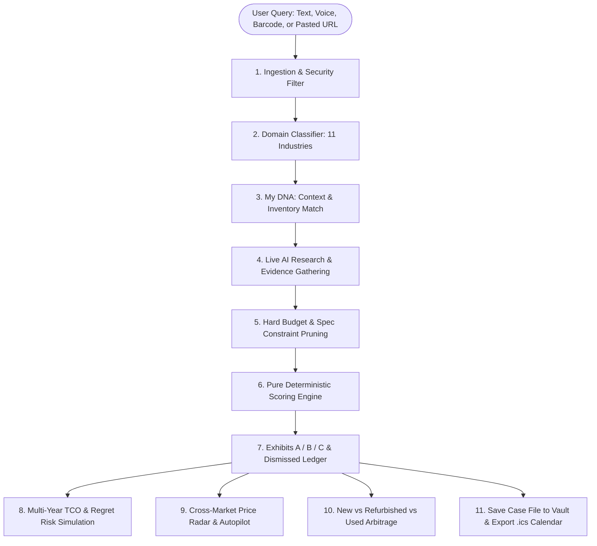

# VERDICT — "See beyond the buy."

[](https://github.com/aryanTmall/Verdict)
[](https://nextjs.org/)
[](https://nodejs.org/)
[](https://www.typescriptlang.org/)
[](https://verdict-u9pt.onrender.com/)

> **A buyer-side AI purchasing and ownership intelligence engine. VERDICT cross-examines marketing claims against verified owner evidence, calculates true Total Cost of Ownership (TCO), learns persistent user buying memory, arbitrates cross-marketplace prices, and protects buyers across 11 core industries with zero vibe math.**

* 🌐 **Live Web Application:** [https://verdict-u9pt.onrender.com/](https://verdict-u9pt.onrender.com/)
* 📂 **GitHub Repository:** [https://github.com/aryanTmall/Verdict](https://github.com/aryanTmall/Verdict)
* 🧠 **Personal Buying Memory:** `/dna` (My DNA Dashboard)
* 🗄️ **Purchase Case Vault:** `/vault` (Warranty & Calendar Sync)
* 📑 **Architecture Specification:** [SPEC.md](SPEC.md)
* 🧪 **Test Verification Suite:** 65/65 Unit & Integration Tests Passing

---

## 📖 Table of Contents

1. [What is VERDICT in 60 Seconds?](#-what-is-verdict-in-60-seconds)
2. [Why We Built It: The Broken Shopping Model](#-why-we-built-it-the-broken-shopping-model)
3. [Key Highlights & Standout Features](#-key-highlights--standout-features)
   - [Personal Buying Memory & My DNA](#1-personal-buying-memory--my-dna-dna)
   - [Deterministic Scoring Engine (Zero Vibe Math)](#2-deterministic-scoring-engine-zero-vibe-math)
   - [Universal AI Live Research Engine](#3-universal-ai-live-research-engine)
   - [Second-Hand, Pre-Owned & Refurbished Intelligence](#4-second-hand-pre-owned--refurbished-intelligence)
   - [Price Radar & Bounded Sale Autopilot](#5-price-radar--bounded-sale-autopilot)
   - [Anti-Hallucination Reality Check & Anti-Upsell Defense](#6-anti-hallucination-reality-check--anti-upsell-defense)
4. [Universal 11-Industry Coverage](#-universal-11-industry-coverage)
5. [End-to-End User Flow](#-end-to-end-user-flow)
6. [Design System: The Legal Case File](#-design-system-the-legal-case-file)
7. [API Reference](#-api-reference)
8. [Codebase Architecture & File Map](#-codebase-architecture--file-map)
9. [Quick Start & Local Setup](#-quick-start--local-setup)
10. [Automated Test Suite](#-automated-test-suite)
11. [Trust-First Ethics Charter](#-trust-first-ethics-charter)

---

## ⚡ What is VERDICT in 60 Seconds?

Most shopping assistants act as digital sales clerks: they regurgitate 5-star manufacturer marketing copy, push products with high affiliate margins, and focus only on closing the sale today.

**VERDICT operates as your personal defense attorney.** 

Before you spend your money, VERDICT cross-examines the purchase:
1. **Audits Claims:** Cross-checks marketing promises against 1-star owner receipts and teardown evidence.
2. **Projects Long-Term Costs:** Simulates a 3- to 5-year Total Cost of Ownership (TCO), factoring in maintenance intervals, battery degradation, and service fees.
3. **Knows You Personally:** Remembers what you already own, your aesthetic tastes, and your budget priorities in **My DNA** so you never buy duplicates or mismatched gear.
4. **Arbitrates Market Conditions:** Recommends whether to buy Brand New, Certified Refurbished, or Pre-Owned based on fair depreciation curves and risk scores.
5. **Enforces Strict Mathematics:** Every score is calculated deterministically with pure TypeScript math—**zero arbitrary LLM hallucinations.**

```
[ Traditional AI Shopping Assistants ]           [ VERDICT Buying Intelligence ]
---------------------------------------           -----------------------------------
Summarizes 5-star ad copy                 -->     Cross-examines verified owner complaints
Pushes high-margin affiliate kickbacks    -->     Algorithms strictly decoupled from monetization
Hallucinates arbitrary "8.9/10" scores    -->     Deterministic multi-criteria math (Sum = 1.0)
Day-1 checkout focus                      -->     Multi-year TCO & maintenance calendar sync
Treats every search in isolation          -->     Remembers your wardrobe, tech stack & lifestyle
```

---

## 🚫 Why We Built It: The Broken Shopping Model

| The Problem | How the Industry Exploits Buyers | How VERDICT Defends You |
| :--- | :--- | :--- |
| **Affiliate Corruption** | Comparison sites promote whatever yields the highest affiliate bounty. | **Trust-First Charter:** Scoring algorithms are 100% blind to affiliate tags. |
| **Vibe Math** | AI chatbots invent fake ratings without clear mathematical benchmarks. | **Normalized Formula:** Every criteria weight is explicit, user-tunable, and sums to 1.0. |
| **Hidden Ownership Costs** | A ₹15L car or ₹40k washing machine hides expensive spare parts, descaling, or service bills. | **Multi-Year Horizon:** Calculates 5-year operational expenditure (fuel, consumables, maintenance). |
| **Upsell Traps** | Retailers push expensive dealer accessories and redundant adapters. | **Smart Pairing:** Flags cosmetic trim and unnecessary dongles as **REDUNDANT**. |
| **Duplicate Purchases** | Buyers forget compatible accessories or clothes they already own. | **Wardrobe & Tech Memory:** Alerts you if a candidate clashes with or duplicates what's in your inventory. |

---

## 🌟 Key Highlights & Standout Features

### 1. Personal Buying Memory & "My DNA" (`/dna`)
* **Structured Preference Engine:** Captures explicit user statements ("I dislike oversized logos", "I work remotely in coffee shops") and infers patterns with full transparency.
* **Style DNA:** Tracks preferred and avoided colors, silhouettes, materials, and aesthetics.
* **Owned Items Inventory:** Stores what you currently own (phones, chargers, watches, coats, appliances). Prevents duplicate purchases and evaluates physical/ecosystem compatibility.
* **Buying DNA:** Calibrates your decision profile (Budget Sensitive, Value Focused, Longevity Priority, or Brand Conscious).
* **Full User Sovereignty:** Users can review, edit, export, or permanently erase any memory entry at any time.

### 2. Deterministic Scoring Engine (Zero Vibe Math)
* Located in `src/lib/engine/`.
* **Hard Constraint Pruning:** Products violating strict criteria (e.g. over-budget or missing essential ports) are rejected to the *Dismissed Candidates* ledger with explicit legal reasoning.
* **Mathematical Invariant:** Scores are normalized across Performance, Reliability, Longevity, and Value:
$$\text{Score}_{\text{final}} = \sum_{i=1}^n \left( w_i \cdot \text{Score}_i \right), \quad \text{where} \quad \sum_{i=1}^n w_i = 1.0$$
* **Shortlist Archetypes:** Every recommended candidate is mapped to an unambiguous role:
  - 🥇 **Exhibit A (BEST OVERALL):** Highest balanced composite score.
  - 💰 **Exhibit B (BEST VALUE):** Highest utility yield per rupee spent.
  - 🛡️ **Exhibit C (BEST ALTERNATIVE):** Safety pick prioritizing long-term reliability and low maintenance risk.

### 3. Universal AI Live Research Engine
* Located in `src/lib/search/research.ts` and `src/lib/llm.ts`.
* Dynamically adapts to **any search query** (e.g., espresso machines, hiking boots, tractors, OLED monitors).
* Multi-provider LLM failover:
  1. **Groq Cloud (Llama 3.3 70B Versatile):** Ultra-low latency deep reasoning.
  2. **Google Gemini (gemini-2.5-flash):** Strict structured JSON schema verification.
  3. **Local Ollama (Llama 3.1):** 100% offline edge inference.
* Produces verified multi-query evidence ledgers with cited owner sentiment.

### 4. Second-Hand, Pre-Owned & Refurbished Intelligence
* Located in `src/lib/second-hand/`.
* **Condition Arbitrage:** Evaluates whether buying Brand New, Certified Refurbished (Amazon Renewed, Cashify), or Pre-Owned (Spinny, Classifieds) is mathematically justified.
* **Empirical Depreciation Curves:** Calculates fair market value tailored for Indian electronics and vehicles.
* **Scam & Anomaly Detection:** Flags listings $> 22\%$ below fair market value as `SUSPICIOUSLY_CHEAP`.
* **Physical Inspection Checklists:** Step-by-step verification guides (e.g. Parivahan NOC for cars, CEIR blacklist & TrueTone check for phones, MDM locks for laptops).
* **1-Click WhatsApp Negotiation Script:** Generates polite, data-backed counteroffers citing market comparables.

### 5. Price Radar & Bounded Sale Autopilot
* Located in `src/lib/price-radar.ts` and `src/lib/sale-autopilot.ts`.
* **Cross-Marketplace Price Check:** Compares live pricing across Amazon, Flipkart, Croma, and Reliance Digital.
* **12-Month Median Price Tracker:** Classifies prices as All-Time Low, Typical Stable Median, or Overpriced Peak.
* **3-Mode Sale Autopilot:**
  - *Mode 1 (Notify Only):* Real-time browser and in-app alerts when target drops occur.
  - *Mode 2 (Approval Required):* Stages the order and requires 1-click dual confirmation.
  - *Mode 3 (Autonomous Snipe):* Executes bounded auto-checkout strictly capped by maximum price limits and idempotency keys.

### 6. Anti-Hallucination Reality Check & Anti-Upsell Defense
* **10-State Query Classifier:** Flags unrealistic budgets (e.g. *"car for ₹5,000"*), conflicting specs (*"lightest laptop with maximum 4K RTX 4090 performance"*), or scam deals (*"iPhone 16 for ₹8,000 on Telegram"*).
* **Smart Pairing:** Audits accessories into `ESSENTIAL`, `RECOMMENDED`, and `REDUNDANT` to stop dealership markups and unnecessary dongle purchases.

---

## 🏭 Universal 11-Industry Coverage

VERDICT includes specialized domain intelligence packs rather than treating all queries like laptops:

| Domain | Key Metrics & Benchmarks | Real-World Examples | 3–5 Year Horizon & Risk Simulation |
| :--- | :--- | :--- | :--- |
| **🚗 Automotive** | ARAI vs Real-World City km/l, NCAP Safety, RTO on-road breakdown | Hyundai Creta, Mahindra XUV700, Tata Harrier | 5-Year fuel costs, scheduled 10k/50k km services, brake wear |
| **💻 Electronics** | Cinebench single-core, RAM expandability, display nits, thermal load | MacBook Air M3, Acer Swift Go OLED, ThinkPad | Battery cycle degradation, soldered RAM obsolescence, thermal throttling |
| **🏢 Real Estate** | Carpet vs Super area, RERA registration, UDS, STP/water source | Prestige Lakeside, Sobha Dream Acres | Society maintenance escalation, water tanker reliance, dampness risks |
| **🧺 Appliances** | BEE star rating, direct-drive motor, operating noise (dB), water use | Bosch Series 6, LG AI Front Load, Deep Freezers | Annual power bills, hard-water scale buildup, replacement gasket costs |
| **👟 Sports & Fitness** | Midsole foam, stack height, heel drop, pronation support, wet grip | Nike Pegasus 41, Asics Gel-Kayano 31 | 800 km midsole foam breakdown curve, cost-per-kilometer analytics |
| **⌚ Fashion & Horology** | Movement caliber, water resistance, crystal material, lug width | Seiko 5 Sports, Tissot PRX, Minimalist Overcoats | Cost-per-wear over 3 years, 5-year mechanical lubrication overhaul |
| **✈️ Travel & Stays** | Beach access, child safety, resort fee transparency, meal plan value | Taj Exotica Goa, Grand Hyatt Bambolim | Mandatory holiday surcharges, monsoon sea roughness, transfer costs |
| **🚜 Agriculture** | PTO horsepower, diesel burn (L/hr), hydraulic lift capacity, dealer radius | Mahindra OJA 4WD, John Deere 3028EN | Diesel burn per acre, 500-hr hydraulic fluid service, implement fatigue |
| **🌬️ Health Tech** | Clean Air Delivery (CADR), HEPA filtration microns, sleep noise | Philips 3000i Air Purifier, Ergonomic Chairs | Annual HEPA replacement costs, optical dust sensor drift |
| **🌐 Commercial Services** | Symmetric throughput, 99.9% uptime SLA, static IPv4, MTTR repair | Airtel Business Dedicated Gigabit Fiber | Monthly recurring leases, downtime penalty clauses, hardware upgrades |
| **🎓 Education** | Weekly hours, WES accreditation, placement track record, project reviews | IIT/UpGrad PG Diploma, Scaler ML | Exam fees, compute lab costs, dropout risk due to excessive workload |
| **🌐 Dynamic Fallback** | Adaptive criteria weighting for any unlisted market category | Drones, Coffee Machines, Power Tools, Musical Gear | Build quality MTBF, consumables expenditure, repairability index |

---

## 🔄 End-to-End User Flow



---

## 🎨 Design System: The Legal Case File

VERDICT uses an editorial aesthetic styled after an **adversarial courtroom case folder**:

* **Folder Parchment (`#F2EBD8`):** Warm courtroom folder background.
* **Evidence Paper (`#FBF7EA`):** High-contrast legal specimen index cards.
* **Archival Jet (`#1B1A17`):** High-legibility typography ink.
* **Docket Blue (`#2540D9`):** Interactive actions, verified citations, and links.
* **Contradiction Red (`#D8381C`):** Evidence defects, red flags, and regret warnings.
* **Verdict Green (`#1F6B4F`):** Affirmed specs and recommended badges.
* **Typography:** Bold headers in **Bricolage Grotesque** with technical specifications rendered in **IBM Plex Mono**.

---

## 🔌 API Reference

| Endpoint | Method | Description |
| :--- | :--- | :--- |
| `/api/mission/parse` | `POST` | Parses natural language queries into structured domain mission parameters. |
| `/api/memory` | `GET/POST/DELETE` | Manages persistent user preferences, style DNA, and buying habits. |
| `/api/memory/items` | `GET/POST/DELETE` | Manages the user's owned items inventory (wardrobe, tech, appliances). |
| `/api/memory/extract` | `POST` | Automatically detects memory candidates from conversational input. |
| `/api/memory/compatibility` | `POST` | Checks prospective purchase compatibility against owned items. |
| `/api/products/analyze-link` | `POST` | Validates pasted product URLs with strict SSRF defense and extracts specs. |
| `/api/products/scan` | `POST` | Recognizes physical products from barcode scans or photos. |
| `/api/price-radar/search` | `GET` | Aggregates live cross-marketplace prices across Amazon, Flipkart, Croma, etc. |
| `/api/products/[id]/used-market` | `GET` | Returns New vs Used vs Refurbished comparison, fair price curves, and negotiation scripts. |
| `/api/products/[id]/price-history` | `GET` | Returns 12-month historical price curves and seasonal deal predictions. |
| `/api/products/[id]/pairings` | `GET` | Audits accessories into Essential, Recommended, and Redundant categories. |
| `/api/sale-autopilot/rules` | `GET/POST` | Registers and monitors autonomous price-drop and snipe rules. |
| `/api/ics` | `POST` | Generates RFC 5545 `.ics` calendar invitation files for maintenance milestones. |
| `/api/voice/transcribe` | `POST` | Transcribes audio queries across 22 scheduled Indian languages and Hinglish. |
| `/api/health` | `GET` | Service health status, memory footprint, and active model providers. |

---

## 📂 Codebase Architecture & File Map

```
Verdict/
├── src/
│   ├── app/                           # Next.js App Router
│   │   ├── api/                       # Modular REST endpoints (30+ routes)
│   │   │   ├── memory/                # Persistent Buying Memory & My DNA endpoints
│   │   │   ├── mission/               # Query parsing & intent classification
│   │   │   ├── price-radar/           # Live price arbitrage endpoints
│   │   │   ├── products/              # Used market, link analysis, pairings, specs
│   │   │   └── sale-autopilot/        # Automated purchase rules & notifications
│   │   ├── dna/                       # Dedicated "My DNA" Personal Intelligence Page
│   │   ├── vault/                     # Case files vault, watchlist & maintenance sync
│   │   ├── page.tsx                   # Main court case file evaluation interface
│   │   └── layout.tsx                 # Root layout & font definitions
│   ├── components/                    # UI Components
│   │   ├── dna/                       # My DNA sections (Style, Buying, Wardrobe, Controls)
│   │   ├── intake/                    # Voice, scan, link input cards
│   │   ├── exhibits/                  # Exhibit A/B/C case cards & score breakdowns
│   │   ├── radar/                     # Price Radar modal & comparison tables
│   │   ├── autopilot/                 # Sale Autopilot rule setup dialogs
│   │   ├── second-hand/               # New vs Used matrix & WhatsApp negotiation drawer
│   │   └── reality/                   # Anti-hallucination & scam advisory banners
│   └── lib/                           # Core Intelligence Engines
│       ├── engine/                    # Pure deterministic scoring math (Zero Vibe Math)
│       ├── domains/                   # 11 Domain Packs (automotive, electronics, etc.)
│       ├── memory/                    # Persistent Memory Engine & compatibility checks
│       ├── search/                    # AI live research planner & evidence ledger
│       ├── second-hand/               # Depreciation models, condition score & checklists
│       ├── buyer-dna.ts               # DNA criteria weight calibration
│       ├── deal-risk.ts               # Seller risk & grey-market anomaly detection
│       ├── price-radar.ts             # Cross-marketplace effective price calculator
│       └── llm.ts                     # Multi-provider LLM adapter (Groq, Gemini, Ollama)
```

---

## 🚀 Quick Start & Local Setup

### Prerequisites
* **Node.js:** `v22.x` or higher ([Download Node.js](https://nodejs.org/))
* **npm:** `v10.x` or higher

### 1. Clone the Repository
```bash
git clone https://github.com/aryanTmall/Verdict.git
cd Verdict
```

### 2. Install Dependencies
```bash
npm install --legacy-peer-deps
```

### 3. Run Development Server
```bash
npm run dev
```
Open **[http://localhost:3000](http://localhost:3000)** in your browser.

### 4. Optional: Configure AI Providers (`.env.local`)
VERDICT operates with built-in fallbacks out of the box. To enable live cloud LLM inference:
```bash
# Optional: High-speed cloud reasoning
GROQ_API_KEY="gsk_your_groq_api_key_here"

# Optional: Google Gemini structured verification
GEMINI_API_KEY="your_gemini_api_key_here"

# Optional: Local Ollama (defaults to http://127.0.0.1:11434 if running)
OLLAMA_BASE_URL="http://127.0.0.1:11434"
```

### 5. Build for Production
```bash
npm run build
npm start
```

---

## 🧪 Automated Test Suite

VERDICT features a comprehensive automated test suite verifying mathematical invariants, domain classification, SSRF protection, and memory management.

```bash
npm test
```

### Test Suite Summary:
```
 ✓ src/lib/engine/index.test.ts (7 tests)
 ✓ src/lib/master-features.test.ts (22 tests)
 ✓ src/lib/memory/memory.test.ts (10 tests)
 ✓ src/lib/search/research.test.ts (11 tests)
 ✓ src/lib/llm.test.ts (5 tests)
 ✓ src/lib/domains.test.ts (10 tests)

Test Files  6 passed (6)
Tests       65 passed (65)
Status      100% Passing
```

---

## ⚖️ Trust-First Ethics Charter

1. **Monetization Decoupled from Algorithmic Scoring:** Affiliate partnerships never influence product ratings, Best Overall badges, or risk warnings.
2. **Zero Sponsored Infiltration:** Commercial listings are strictly quarantined and never placed in Exhibit A (Best Overall).
3. **No Fabricated Data:** If verified owner review evidence is unavailable, VERDICT states *"Insufficient owner data"* rather than hallucinating praise.
4. **User Data Sovereignty:** Personal buying memory, wardrobe data, and preferences reside under user control and can be exported or purged at any time.

---

## 📄 License

This project is licensed under the **MIT License**.  
Built with pride for the **IST Hackathon — Reimagining Shopping with AI**.
